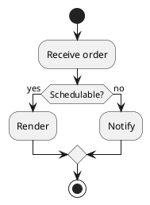

# PlantUML figures

For a straightforward flowchart or decision tree, use the requested form directly. For a paper, report, or hard-to-read existing diagram, read `references/figure-selection.md` relative to this skill directory before writing PlantUML.

1. Identify the question the reader needs this figure to answer. Use the relevant paragraph, caption, data, and existing figure as evidence. If two plausible readings would change the diagram and the source does not resolve them, ask one focused question.
2. Match the main relationship to a layout. For example, a layer **contains** a module; it does not send data to it. Use position for membership and reserve arrows for relationships you can name. Leave secondary details in the caption or text. Split the figure if it needs two incompatible readings.
3. Render and inspect a draft. Check labels, directions, branch outcomes, and numbers against the source. View the image at the intended insertion width: verify that text (including Chinese) is readable, labels do not overlap, and the reading order still works without color. If the target journal or page size is unknown, do not claim submission compliance.
4. Deliver the editable `.puml` and the requested image, preferably SVG for a scalable report figure. When asked for a preview, keep it separate from the originals until approved.

## Rendering

The jar is bundled in this skill directory as `plantuml-1.2026.10.jar`. Resolve it against the skill directory path Pi reports for this skill — not against the workspace, and not against any hardcoded user path:

```bash
java -jar "<skill-dir>/plantuml-1.2026.10.jar" -charset UTF-8 --no-error-image "diagram.puml"
```

Use the actual source path in place of `diagram.puml`. This writes a PNG next to the source; add `-tsvg` for SVG. Do not treat `-DPI=300` as proof of print resolution. For raster delivery, check the actual pixel dimensions against the requested physical size. Check the render exit status and open the output: an existing file alone does not prove that the diagram rendered correctly.

## Syntax Conventions

PlantUML is not Mermaid. `flowchart TB`, `graph TB` and `A[label]` are Mermaid notation and fail with `Error line N` — do not use them.

- Wrap every diagram in `@startuml` / `@enduml`.
- Links: `A --> B`, labelled `A --> B : yes`.
- Branches: activity syntax, the reliable shape for a flowchart:



- `left to right direction` works for link-style diagrams only; combined with activity syntax (`start` / `:label;`) it fails at the `start` line. Activity flows are vertical.
- One diagram per `.puml` file. **Save `.puml` files in the user's project folder, never in the skill folder.** The skill folder is reserved for `SKILL.md` and skill assets only.
