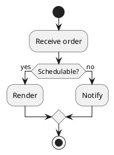

# PlantUML Flowchart

## Rendering

The jar is bundled in this skill directory as `plantuml-1.2026.6.jar`. Resolve it against the skill directory path Pi reports for this skill — not against the workspace, and not against any hardcoded user path:

```bash
java -jar "<skill-dir>/plantuml-1.2026.6.jar" <file>.puml
```

Writes `<file>.png` next to the source.

Raster resolution is not adjustable in this CLI: `-DPI` is silently ignored — `-DPI=100` and `-DPI=300` produce byte-identical PNGs and `-help` lists no such option. When the output must survive zooming or printing, emit SVG instead with `-tsvg`.

## Syntax Conventions

PlantUML is not Mermaid. `flowchart TB`, `graph TB` and `A[label]` are Mermaid notation and fail with `Error line N` — do not use them.

- Wrap every diagram in `@startuml` / `@enduml`.
- Links: `A --> B`, labelled `A --> B : yes`.
- Branches: activity syntax, the reliable shape for a flowchart:



- `left to right direction` works for link-style diagrams only; combined with activity syntax (`start` / `:label;`) it fails at the `start` line. Activity flows are vertical.
- One diagram per `.puml` file. **Save `.puml` files in the user's project folder, never in the skill folder.** The skill folder is reserved for `SKILL.md` and skill assets only.
