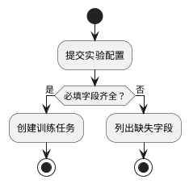

# Choose the relationship before choosing the diagram

Use the supplied material, not a generic picture of how a system ought to work. Try a one-sentence caption: “This figure shows **X** so that the reader can understand **Y**.” Keep the items and relationships needed to support that sentence. A chapter title such as “Methods” is not enough to choose a flowchart.

| Reader's question | PlantUML composition | What would mislead the reader? |
|---|---|---|
| What belongs where? | Layered architecture or research framework: label the layers on the left; put peer modules in aligned, square-cornered groups on the right. Mark optional components in words. | Arrows between every pair of layers suggest calls or a sequence that the source may not assert. |
| How is an experiment carried out? | Activity diagram: group actions by stage, follow one main path, label each decision outcome. Give exclusions and failures a short side path to their actual outcome. | Making an error the main path, or merging a rejected sample back into the experiment. |
| How do inputs become outputs? | Model or data-flow diagram: put independent inputs or branches side by side, join them only at the named transformation, then show the output. | Turning independent sources into consecutive steps; inventing a fusion method, tensor shape, or loss. |
| When does a task change state? | State diagram: name states as conditions and transitions by their triggers. Include only transitions in the source. | Drawing actions as states, or inventing a retry from a terminal state. |
| Which entities or roles are related? | Use an entity or use-case diagram when identity, cardinality, or participation is the point. | Implying a database foreign key from a file reference, or access permissions from a user's role. |
| How do measured results compare? | First check metrics, units, populations and data provenance. If the result belongs in a table or statistical plot, say so; don't substitute a UML diagram. | Drawing comparable-looking bars for accuracy, mean squared error and silhouette score; inventing missing values or significance. |

**Meaning before decoration.** Label a connection by what it means (e.g. “submits”, “produces”, “on cancellation”), not by what fits. Do not turn an observed association into a cause or a proposed mechanism into an established one. If a distinction matters, express it with wording or a legend, not just color. Keep the same term for the same entity across panels and in the caption.

## Two views of the same fictional training service

**Source for these examples:** the configuration and results pages are presentation modules. The business layer manages training jobs and queries results; the data layer holds local sample and model-result files. On configuration submission, the service creates a job if the required fields are present; otherwise it reports the missing fields without creating a job.

### “What modules does the service contain?”

Draw membership, not execution order. The hidden links only align cells; none claims a dependency. This example uses the layout bundled in the jar. Adapt the number of columns to the actual modules rather than inventing items to fill the grid.

```plantuml
@startuml
!pragma layout smetana
skinparam shadowing false
skinparam roundCorner 0
skinparam defaultFontName SansSerif
skinparam rectangle {
  BorderColor #647580
  BackgroundColor #F3F6F7
}
rectangle "<b>表示层" as UI #D8E6EB
rectangle "实验配置页面" as Form
rectangle "结果查看页面" as View
rectangle "<b>业务层" as Service #D8E6EB
rectangle "训练任务管理" as Train
rectangle "实验结果查询" as Query
rectangle "<b>数据层" as Data #D8E6EB
rectangle "本地样本文件" as Samples
rectangle "模型结果文件" as Results

UI -[hidden]right-> Form
Form -[hidden]right-> View
Service -[hidden]right-> Train
Train -[hidden]right-> Query
Data -[hidden]right-> Samples
Samples -[hidden]right-> Results
UI -[hidden]down-> Service
Service -[hidden]down-> Data
@enduml
```

### “When does a submission become a training job?”

Keep the field check and both outcomes; omit the results page and storage layout. Neither answers this question.

**Review at page size.** Read only the headings and the main path first: do they answer the caption's question? Then trace each exception or input to its destination. If a caption is needed to explain a tangle of arrows, revise the layout before changing the palette. If text is too small, shorten labels or split the figure rather than shrinking the type. Missing glyphs require a font available on the rendering machine that covers the text; no theme guarantees this across platforms.
